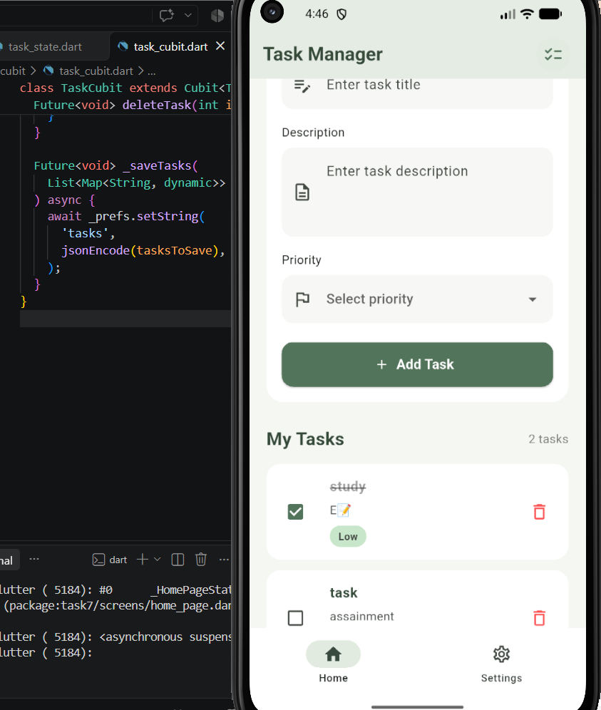
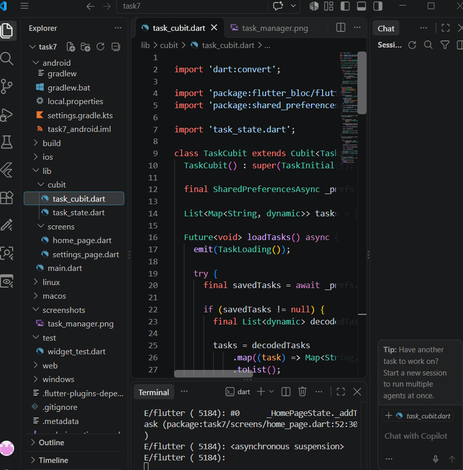
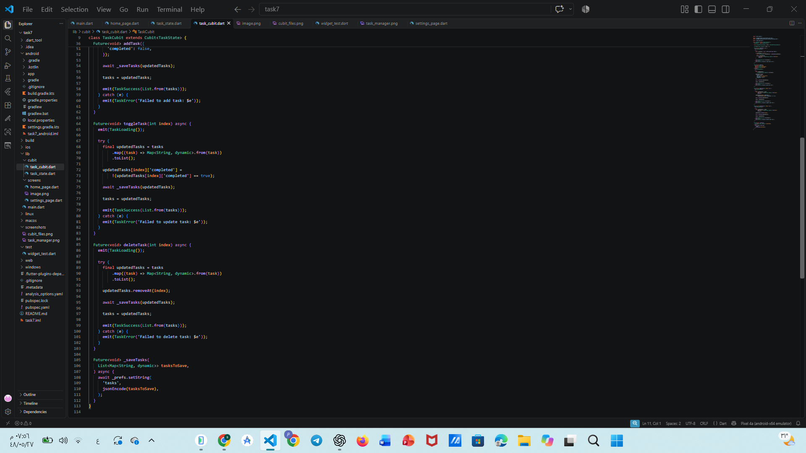

# Task Manager – Task 7

## State Management Using Cubit

Implemented task management using **Cubit** and `flutter_bloc`.

## Features

- Add new tasks.
- Update task completion status.
- Delete tasks.
- Save tasks locally using SharedPreferences.

## States

- **TaskInitial:** Initial state.
- **TaskLoading:** Loading state.
- **TaskSuccess:** Operation completed successfully.
- **TaskError:** Operation failed.

## State Flow

1. `BlocProvider` provides `TaskCubit`.
2. The UI calls Cubit methods.
3. `TaskCubit` handles task operations and saves data.
4. `emit()` updates the current state.
5. `BlocBuilder` listens to state changes and updates the UI.

## Screenshots

### Home Screen

### Cubit and State Files

### Cubit Implementation

## Technologies

- Flutter
- Dart
- flutter_bloc
- SharedPreferences
